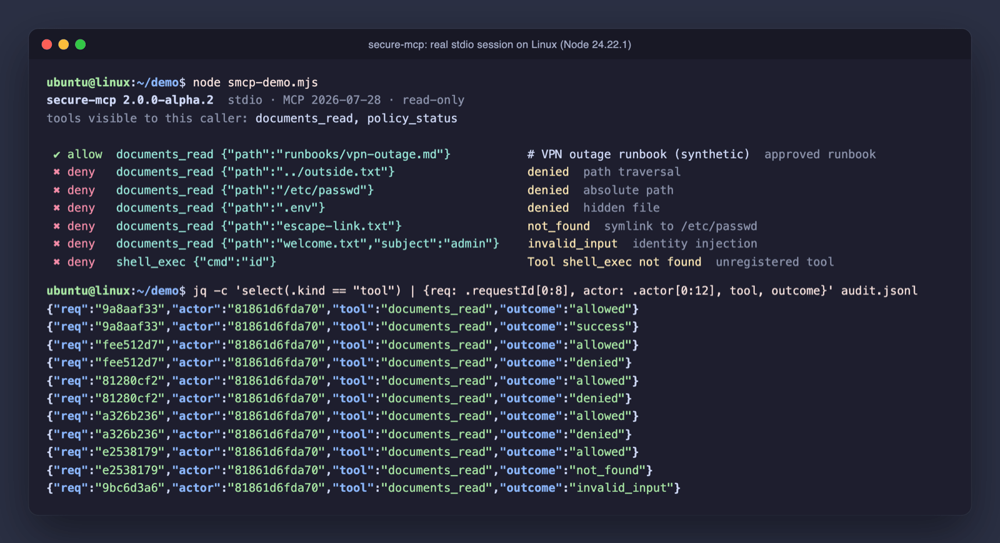
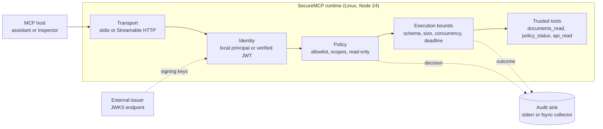
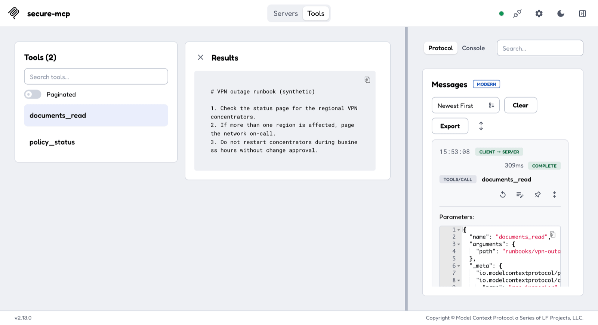
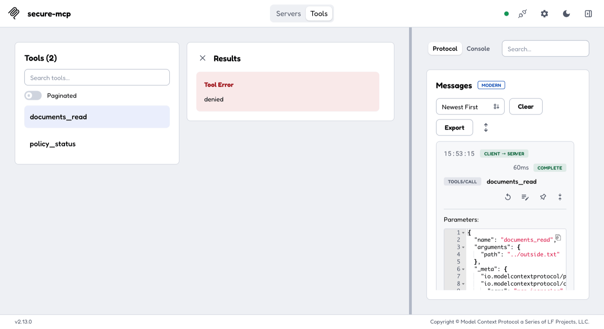
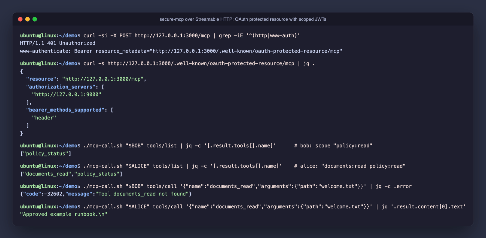

<div align="center">

# SecureMCP

**A policy-enforcing runtime for Model Context Protocol (MCP) tools.**<br>
Approved tools only. Verified callers. Bounded execution. A content-free audit trail.

[](https://github.com/perfecxion-ai/secure-mcp/actions/workflows/ci.yml)


[](LICENSE)

</div>

<p align="center">
  
</p>

<p align="center"><sub>Real output from the alpha.2 CLI on Linux. Each decision becomes a content-free audit record: a server-generated request ID, a pseudonymous actor hash, the tool name and an outcome. <code>allowed</code> marks admission past policy and schema checks; the second record carries the handler's final result.</sub></p>

> [!IMPORTANT]
> **Version 2 is an incompatible alpha.** It replaces the v1 prototype, whose known defects are documented in the [assessment](https://github.com/perfecxion-ai/secure-mcp/blob/6fec1886ca2e400694007819384105fdba9eb6a6/docs/reviews/2026-10-26-assessment.md). Do not treat the current branch as a production security boundary without reviewing its [threat model](docs/THREAT_MODEL.md).

## Contents

- [Why SecureMCP](#why-securemcp)
- [How it works](#how-it-works)
- [See it in action](#see-it-in-action)
- [Quick start](#quick-start)
- [Remote mode: Streamable HTTP with OAuth](#remote-mode-streamable-http-with-oauth)
- [Extend with a trusted tool](#extend-with-a-trusted-tool)
- [Security model](#security-model)
- [Project status](#project-status)
- [Development](#development)
- [Documentation](#documentation)
- [License](#license)

## Why SecureMCP

MCP lets an AI assistant call tools on your behalf, so the server that exposes those tools decides what the assistant can actually reach. SecureMCP is that server-side boundary. It is an experimental TypeScript runtime built on the official MCP SDK:

- **Allowlist, not denylist.** Only tools named in configuration exist. Discovery and invocation share one policy, so a caller never sees a tool it cannot run.
- **Identity comes from the transport, never from arguments.** Local stdio callers receive the operator's configured scopes. Remote callers must present a short-lived JWT access token from your issuer. Tool arguments and request metadata cannot select a principal.
- **Every call is bounded.** Strict input schemas, input and output size limits, a collection-entry budget, a concurrency cap, deadlines, cooperative cancellation and a bounded shutdown.
- **Document reads stay inside the workspace.** The built-in reader opens each path component relative to an open directory handle and rejects symlinks, hidden names, traversal and special files.
- **Audit without leakage.** Correlated JSON events record decisions and outcomes, never arguments, paths, tokens or document content. If an admission record cannot be written, the call does not run.

| Capability | Status |
| --- | --- |
| stdio and Streamable HTTP | Official SDK, tested with modern (`2026-07-28`) and legacy (`2025-11-25`) clients |
| Tool visibility and execution policy | Explicit allowlist, all required scopes, read-only mode |
| Remote identity | External JWT issuer, pinned JWKS URL, `typ: at+jwt`, audience and lifetime validation, OAuth protected resource metadata |
| Execution bounds | Input and output limits, concurrency, deadlines, cancellation, shutdown |
| Documents | Linux workspace confinement, no symlinks or hidden paths, bounded UTF-8 reads |
| API example | Optional single fixed URL, GET only, redirects denied |
| Audit and metrics | Correlated content-free events, bounded delivery, optional fsync-acknowledged collector, authenticated metrics |
| Package and container | CLI and side-effect-free library; local consumer smoke checks; SBOM and build provenance attested by CI |
| Untrusted plugin sandbox, content screening, gateway | Not implemented |
| Certification, production readiness, universal prompt-injection prevention | Not claimed |

The tool registry contains `documents_read`, `policy_status`, and optional `api_read`. Enable the API tool by configuring `api.url`, adding `api_read` to `allowedTools`, and granting `api:read`. It accepts no caller-controlled URL or headers.

## How it works



1. The **transport** accepts a stdio session or an HTTP request. HTTP validates the Host and Origin headers before authentication.
2. **Identity** is fixed at the transport boundary: the local operator principal for stdio, or the verified token subject and scopes for HTTP.
3. **Policy** decides which tools are visible and callable. A tool must be allowlisted, every required scope must be present, and read-only mode blocks tools that declare side effects.
4. **Execution bounds** reserve a capacity slot and a deadline, validate input exactly once inside them, and then run the handler.
5. **Audit** records admission and the terminal outcome with a server-generated request ID. Arguments and results never enter the audit stream.

## See it in action

**Allowed.** The official MCP Inspector reads an approved runbook over protocol `2026-07-28`. The protocol panel shows the exact `tools/call` request.

<p align="center">
  
</p>

**Denied.** The same tool refuses `../outside.txt` with a stable error code. Nothing from outside the workspace is returned.

<p align="center">
  
</p>

<sub>Captured from macOS with MCP Inspector 2.13. The server ran on Linux in a container and was launched over stdio with <code>docker exec -i</code>. This illustrates the workflow; it is not a native macOS support claim.</sub>

## Quick start

**Requirements:** Linux, Node `>=24.22.1 <25`, and npm 11. Select Node explicitly in a non-login shell: load nvm and run `nvm use 24.22.1`, or prepend the supported Node installation's `bin` directory to `PATH`. No database, paid service, or API key is needed for local documents.

### 1. Install the alpha.2 candidate

Alpha.2 is **not available on npm**. A frozen alpha.2 candidate is recorded in [docs/validation/ALPHA2.md](docs/validation/ALPHA2.md) and is distributed for independent trials through an authenticated maintainer handoff. Alpha.1 remains a [GitHub prerelease](https://github.com/perfecxion-ai/secure-mcp/releases/tag/v2.0.0-alpha.1), excluded from npm promotion. A checksum shipped with an untrusted archive does not authenticate it. To verify build provenance and the signed SBOM yourself, follow the [verification and trial guide](docs/validation/REAL_USER_VALIDATION.md).

Run this in Bash after setting `MCP_TARBALL` to the absolute path of the received tarball and `MCP_EXPECTED_SHA256` to its independently trusted digest. No checkout, build, `npm ci`, or GitHub CLI is required for a maintainer-verified handoff:

```bash
: "${MCP_TARBALL:?Set the absolute path to the verified tarball}"
: "${MCP_EXPECTED_SHA256:?Set the digest from the authenticated handoff}"
printf '%s  %s\n' "$MCP_EXPECTED_SHA256" "$MCP_TARBALL" | sha256sum --check - || exit 1
MCP_NODE="$(node -p 'process.execPath')"
MCP_TRIAL="$HOME/secure-mcp-trial"
mkdir -m 700 "$MCP_TRIAL" || exit 1
mkdir "$MCP_TRIAL/install" "$MCP_TRIAL/documents"
printf 'Approved example runbook.\n' > "$MCP_TRIAL/documents/welcome.txt"
cd "$MCP_TRIAL/install" || exit 1
npm init -y
npm install --save-exact --ignore-scripts "$MCP_TARBALL" || exit 1
MCP_CLI="$MCP_TRIAL/install/node_modules/@perfecxion/secure-mcp-server/dist/cli.js"
"$MCP_NODE" "$MCP_CLI" --doctor --workspace "$MCP_TRIAL/documents"
```

The script refuses to reuse an existing trial directory, installs with lifecycle scripts disabled, and finishes with `--doctor`, which prints a JSON summary of the effective transport, tools and limits. Keep `package-lock.json`, the tarball, and the trusted digest with the trial. Dependencies still require registry access. The real entry point is `dist/cli.js`. Doctor checks local configuration and workspace access only; it does not establish issuer or collector availability.

### 2. Connect an MCP host

The host launches the same command without `--doctor`. The [installation guide](docs/INSTALL.md) generates absolute-path configuration for Cursor and VS Code, then walks through a first session: read `welcome.txt`, confirm `../outside.txt` is denied, inspect the audit output, and restart. The generated Cursor entry has this shape:

```json
{
  "mcpServers": {
    "secure-mcp-validation": {
      "command": "/absolute/path/to/node",
      "args": [
        "/home/you/secure-mcp-trial/install/node_modules/@perfecxion/secure-mcp-server/dist/cli.js",
        "--workspace",
        "/home/you/secure-mcp-trial/documents"
      ]
    }
  }
}
```

VS Code and Cursor configuration formats differ. On a macOS or Windows desktop, keep Node, the installation and the documents on Linux; the guide covers the Remote-SSH and Streamable HTTP options.

### 3. Try a useful workflow

The [sanitized alert-triage demo](docs/DEMO.md) combines an alert, approved asset context and a runbook into a brief with explicit unknowns. It exercises resource authorization, a denied resource, rejected identity injection, audit failure and recovery using harmless fixtures. It ships with the package, so it runs from the same Bash session:

```bash
MCP_EXAMPLE="$MCP_TRIAL/install/node_modules/@perfecxion/secure-mcp-server/examples/triage"
"$MCP_NODE" "$MCP_EXAMPLE/verify.mjs" > "$MCP_TRIAL/triage-evidence.json"
```

These examples are engineering demonstrations; independent repeat-use and external integration evidence remain open.

### After an npm publication decision

Only after a separate npm publication decision, the intended exact-version install is:

```bash
# Future command; alpha.2 is not yet published.
npm install --save-exact --ignore-scripts @perfecxion/secure-mcp-server@2.0.0-alpha.2 --registry=https://registry.npmjs.org/
```

> [!WARNING]
> Do not use an unqualified install: `latest` remains v1. The `alpha` tag is mutable, and a range such as `^2.0.0-alpha.2` can admit later releases. Exact pins and the consumer lockfile preserve the reviewed selection.

## Remote mode: Streamable HTTP with OAuth

Over HTTP, SecureMCP acts as an OAuth 2.0 protected resource. It verifies access tokens from an external issuer on every request; it does not issue, refresh or revoke tokens. Start from the packaged [`examples/http.json`](examples/http.json):

```json
{
  "transport": "http",
  "workspace": "./documents",
  "allowedTools": ["documents_read", "policy_status"],
  "readOnly": true,
  "http": {
    "host": "127.0.0.1",
    "port": 3000,
    "resource": "https://mcp.example.com/mcp",
    "issuer": "https://identity.example.com",
    "jwksUrl": "https://identity.example.com/.well-known/jwks.json",
    "algorithms": ["RS256"],
    "allowedOrigins": [],
    "maxTokenAgeSeconds": 900
  }
}
```

Copy it to an operator-owned directory, replace the resource, issuer and JWKS URLs, then run `"$MCP_NODE" "$MCP_CLI" --config /path/to/http.json`. Access tokens must be asymmetrically signed (RS256 by default; ES256 and EdDSA are opt-in), carry `typ: at+jwt`, and include `iss`, an exact resource `aud`, `sub`, `iat`, `exp` and a space-separated `scope`. Lifetime and age are capped by `maxTokenAgeSeconds`. Tools need `documents:read`, `policy:read` or `api:read`; `/metrics` needs `metrics:read`.

<p align="center">
  
</p>

<p align="center"><sub>A local lab issuer minted two RS256 access tokens. Bob holds <code>policy:read</code> and never discovers <code>documents_read</code>; Alice holds both scopes and can read. <code>mcp-call.sh</code> is a three-line <code>curl</code> wrapper.</sub></p>

Terminate TLS in a reverse proxy that preserves the configured resource hostname in `Host`, and bind the runtime to loopback when the proxy runs on the same host. Have that proxy buffer request bodies and limit per-client connections and request rates; the runtime's own connection and request limits are deliberately small and are shared by authenticated and unauthenticated clients. See [operations](docs/OPERATIONS.md) for collectors, metrics, health checks and shutdown.

## Extend with a trusted tool

```typescript
import { SecureRuntime, defineTool, textResult } from '@perfecxion/secure-mcp-server';
import { serveStdio } from '@modelcontextprotocol/server/stdio';
import { z } from 'zod';

const runtime = await SecureRuntime.create({
  config: { allowedTools: ['greet'], localScopes: ['greet:read'] },
  tools: [
    defineTool({
      name: 'greet',
      description: 'Return a greeting',
      requiredScopes: ['greet:read'],
      readOnly: true,
      inputSchema: z.strictObject({ name: z.string().max(80) }),
      async invoke({ name }) {
        return textResult(`Hello, ${name}`);
      },
    }),
  ],
});
const transport = serveStdio(() => runtime.createServer(runtime.localPrincipal()));
// The embedding application owns signal handling and shutdown:
// await runtime.close(); await transport.close();
```

For a separate TypeScript application using this example, declare compatible `zod` and `@modelcontextprotocol/server` dependencies and Node types in that application. The [trusted-tool guide](docs/TRUSTED_TOOLS.md) walks through a complete external consumer built only on public exports.

Custom schemas run once inside the runtime, including transforms, defaults, coercion, and asynchronous refinements. Validation shares the execution deadline and capacity limit. Invoke tools through the runtime; `ToolDefinition.invoke` is the handler callback for already validated values. Keep refinements free of side effects.

Handlers are trusted process code. Policy checks do not sandbox malicious implementations. Production embeddings must own transport closure, audit failures, and cancellation.

## Security model

<table>
  <tr>
    <th width="50%">Enforced by the runtime</th>
    <th width="50%">Outside the guarantee</th>
  </tr>
  <tr valign="top">
    <td>
      <ul>
        <li>Tool allowlist, all required scopes, token expiry and read-only policy for both discovery and invocation</li>
        <li>Identity only from the transport boundary, never from arguments or <code>_meta</code></li>
        <li>Strict schemas that reject unknown fields, plus input, output, collection and concurrency limits</li>
        <li>Per-component <code>O_NOFOLLOW</code> document opens relative to the workspace handle; regular files only</li>
        <li>Host and Origin checks before authentication; asymmetric JWTs only; JWKS fetched only from the configured URL</li>
        <li>Content-free, correlated audit events; failed admission audit prevents execution</li>
      </ul>
    </td>
    <td>
      <ul>
        <li>Malicious handler code: handlers run with full Node process privileges</li>
        <li>Hostile local writers and pre-existing hard links inside the workspace</li>
        <li>Per-document or per-tenant authorization beyond tool scopes</li>
        <li>Immediate token revocation or opaque-token introspection</li>
        <li>Durable audit retention (stderr is not durable storage)</li>
        <li>Prompt injection that persuades an agent to use authority it already holds</li>
      </ul>
    </td>
  </tr>
</table>

<details>
<summary><b>Boundary details</b></summary>

- Handlers are trusted Node process code. Read-only declarations and cancellation depend on their cooperation; this is not a sandbox.
- Document access assumes a trusted workspace. Traversal and symlinks are rejected; existing hard links and hostile local writers remain outside the guarantee. Prepare trusted copies and a dedicated read-only mount.
- Scopes authorize tools. Every caller with document access can read within the configured workspace; there is no per-document or tenant isolation without additional authorization or deployment separation.
- Remote authentication requires the documented JWT access-token type, issuer, audience, scopes and lifetime. There is no opaque-token introspection or immediate revocation.
- Audit delivery failure or saturation can latch the service unhealthy until restart. Stderr is not durable storage; the reference collector is not a production retention system.
- Prompt injection can still persuade an agent to exercise already granted authority.

</details>

Read the [threat model](docs/THREAT_MODEL.md), [operations guide](docs/OPERATIONS.md), and [security policy](SECURITY.md) before deployment. Report vulnerabilities privately as described in [SECURITY.md](SECURITY.md).

### Compatibility with v1

**This is not an ordinary v1 upgrade.** V2 uses ESM exports, explicit startup and standard MCP transports. Old accounts, credentials, endpoints and client protocols are not migrated. The package supports Linux only. npm v1 declares Apache-2.0; v2 declares **AGPL-3.0-or-later**. Review the [migration and license notice](docs/MIGRATION.md) before adoption. Keeping `latest=1.0.0` protects compatibility and does not endorse v1's security.

## Project status

| Milestone | State |
| --- | --- |
| Alpha.1 | Historical [GitHub prerelease](https://github.com/perfecxion-ai/secure-mcp/releases/tag/v2.0.0-alpha.1); excluded from npm promotion |
| Alpha.2 candidate | Frozen, built once by protected-main CI, with verified provenance and signed SBOM ([record](docs/validation/ALPHA2.md)) |
| Independent human trials | Open: VS Code and Cursor receipts with restart and repeat use |
| Remote operator evidence | Open: an independent issuer and audit deployment |
| npm publication | Not approved; a separate decision for one exact artifact |

Every push to `main` runs typecheck, lint, formatting, the Node test suite, build and schema checks, security mutation checks, dependency audits, OAuth, audit, storage-failure, TLS proxy and container labs, short benchmarks, a production SBOM, and a fresh-consumer smoke test of the exact packed tarball before attesting it. Follow the [active execution plan](https://github.com/perfecxion-ai/secure-mcp/issues/57) for remaining gates and the [original roadmap](https://github.com/perfecxion-ai/secure-mcp/blob/6fec1886ca2e400694007819384105fdba9eb6a6/docs/ROADMAP.md) for background.

## Development

From a source checkout, using the supported Node version:

```bash
npm ci
npm run check            # typecheck, lint, format, tests, build, release metadata, config schema
npm run test:package     # pack and install the tarball in a fresh consumer
npm run test:container   # build and exercise the container image (Docker required)
npm run test:mutations   # confirm weakened security controls are caught
npm audit
```

The Node test suite exercises real SDK transports, signed access tokens, local JWKS, cross-user policy, filesystem escape attempts, cancellation, and output limits. V1 tests and manifests are preserved in [legacy](https://github.com/perfecxion-ai/secure-mcp/blob/6fec1886ca2e400694007819384105fdba9eb6a6/legacy/README.md), with their original failures recorded rather than treated as passing.

<details>
<summary><b>Integration labs</b></summary>

| Command | What it exercises |
| --- | --- |
| `npm --prefix labs/oauth ci && npm run test:oauth` | Client credentials and authorization code with S256 PKCE against an external issuer |
| `npm run test:keycloak` | Real Keycloak with PostgreSQL, headless Chromium login and consent, key rotation, issuer outage, logout, expiry and code replay (Docker, several minutes) |
| `npm run test:proxy` | NGINX TLS termination with certificate, Host and Origin rejection (Docker) |
| `npm run test:audit` | The fsync-acknowledged collector process, kill and restart persistence, journal limits and blocked delivery |
| `node labs/audit/storage-failure.mjs` | Collector behavior when its storage fails (Docker) |
| `node labs/hosts/verify.mjs --host claude` (or `codex`) | Optional real assistant hosts; consumes model quota |
| `npm run benchmark`, `npm run benchmark:http` | Runtime and HTTP benchmarks; see [benchmarks](docs/BENCHMARKS.md) |

</details>

Configuration is defined by `src/config.ts` and rejects unknown keys; `config.schema.json` is generated from it for editor support. See [contributing](CONTRIBUTING.md) for PR expectations.

## Documentation

| Guide | Use it to |
| --- | --- |
| [Installation](docs/INSTALL.md) | Generate host configuration and complete a first session |
| [Alert-triage demo](docs/DEMO.md) | Run a realistic workflow with resource authorization and audit recovery |
| [Trusted tools](docs/TRUSTED_TOOLS.md) | Build a separate consumer using public exports |
| [Operations](docs/OPERATIONS.md) | Configure HTTP, collectors, metrics, containers and shutdown |
| [Threat model](docs/THREAT_MODEL.md) | Understand trust boundaries and remaining assurance gaps |
| [Migration](docs/MIGRATION.md) | Move from v1 and review the license change |
| [Verification and trial guide](docs/validation/REAL_USER_VALIDATION.md) | Verify a candidate and record a trial |
| [Releasing](docs/RELEASING.md) and [npm publishing](docs/NPM_PUBLISHING.md) | Follow the maintainer release gates |

## License

AGPL-3.0-or-later. The npm v1 package advertises Apache-2.0; v2 is an incompatible successor with different license metadata. See [LICENSE](LICENSE) and [NOTICE](NOTICE).
