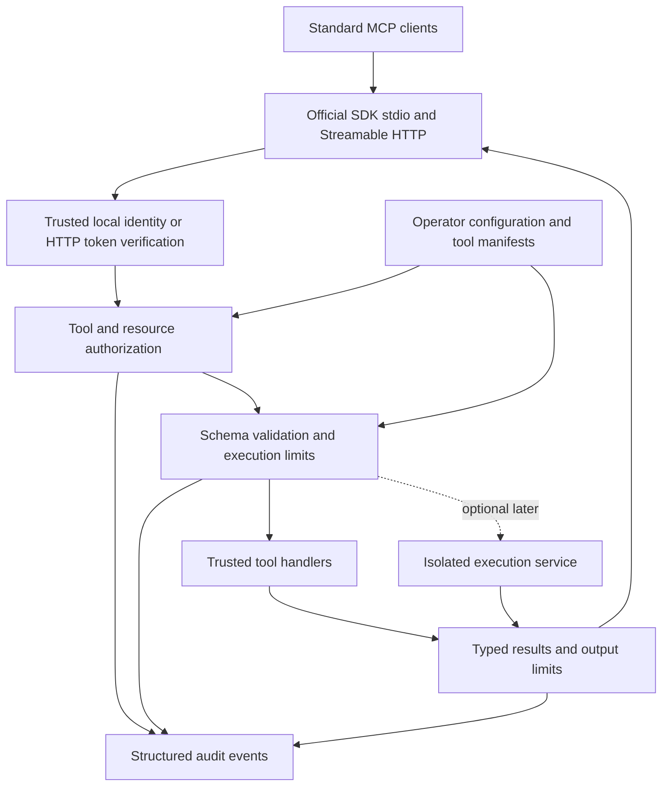

# Secure MCP execution roadmap

Status: implementation in progress, October 26, 2026. Baseline: `1df0af55bd2cebde48d643e3d3c852e64d37ce18`. The first local alpha is implemented; see [the execution record](EXECUTION.md) for evidence, PR boundaries, and remaining gates. This plan follows the [repository assessment](reviews/2026-10-26-assessment.md) and its reproducible findings.

**Recommended direction: a small, standards-compliant TypeScript MCP server runtime for hosting approved tools with enforceable access policies, bounded work, and reliable audit evidence.** The runtime direction is the working assumption used for this plan. A gateway for upstream servers and an AI security assessment tool server are distinct product directions and should not be silently combined into this release.

## Product promise and target users

The primary user is a developer exposing internal tools to assistants who needs to answer: which caller can invoke which operation, against which resources, under what limits, and how can an operator verify the decision afterward? The secondary user is the security engineer validating those boundaries before deployment.

The first experience should be concrete: install the package, configure one approved local document source, connect a standard MCP client, read an allowed document, observe an out-of-scope read being denied, and inspect the corresponding audit event. A remote example should demonstrate the same policy with externally issued access tokens.

The differentiator is the quality and transparency of those controls. A large catalog of generic tools, homemade identity services, enterprise deployment templates, and regex filters would not establish that value.

The initial release should support:

- Standard stdio and Streamable HTTP through the maintained official SDK.
- A small, typed registry of trusted tool implementations, with schema validation and stable results.
- The same authorization policy for discovery and invocation, plus resource-specific checks before execution.
- Explicit read-only mode, tool allowlists, time and size limits, cancellation, and concurrency limits.
- Structured audit events that identify the policy decision without recording raw secrets or tool content by default.
- A working CLI, a side-effect-free library API, and tested npm/container artifacts.
- One useful local document example and one fixed-destination, read-only API integration example.

General upstream proxying, dynamic untrusted plugins, arbitrary command execution, built-in accounts/MFA/SAML, multi-region orchestration, and certification claims are outside the initial scope. An optional Prisma AIRS or other screening adapter may follow a stable provider interface; the open source core must work without a paid service or vendor account.

## Release strategy

Use a new major prerelease channel for the incompatible API and transport changes, provisionally `2.0.0-alpha.*`, then beta and release candidate stages. Confirm published versions and consumers before assigning an exact version. Do not reset a published package to 0.x or promise compatibility with interfaces that never worked.

Before removing legacy behavior, inventory actual deployments, account/token storage, custom tools, and reliance on the client SDK. If deployed users exist, prioritize a narrowly scoped security patch and migration instructions before the successor release. Any retained credential records need an explicit migration or invalidation strategy; the current MFA ciphertext must not be represented as securely encrypted at rest.

Preserve the repository's history. Remove old modules from the default import graph once replacements pass their gates. Keep a legacy branch or documented release reference if needed, rather than carrying unsupported security systems into the new runtime.

The work below is approximately 45 to 65 focused engineering days for one maintainer, with substantial uncertainty around migration and external client behavior. Optional untrusted-code isolation adds a separate workstream. These are planning estimates, not a release date; progress is determined by acceptance gates.

## Target architecture



Keep composition in a server factory and lifecycle ownership in the CLI. Initial module boundaries can remain within one package:

| Boundary | Responsibility | Important constraint |
| --- | --- | --- |
| `core` | Server factory, tool registry, shared result/error contracts | No automatic listeners, database connections, or process exit on import |
| `transports` | SDK stdio and HTTP adapters | No independent wire protocol implementation |
| `identity` | Trusted request principal and HTTP token verification | Caller-supplied tool arguments cannot select identity or tenant |
| `policy` | Tool visibility, invocation, and resource decisions | Deny by default, explicit composition rules, bounded evaluation |
| `execution` | Deadlines, cancellation, concurrency, and result bounds | In-process handlers are trusted code, not sandboxed code |
| `audit` | Decision events, metrics, optional tracing export | No raw prompts, arguments, tokens, or resource contents by default |
| `adapters` | Optional secret, state, content screening, and tool providers | Dependencies and credentials loaded only when enabled |
| `cli` | Configuration validation, start, doctor, local policy diagnostics | Secrets excluded from diagnostics; stdio stdout reserved for protocol |

PostgreSQL, Redis, and Vault should not be mandatory for a local read-only server. Add persistence only for an identified requirement. The current MCP core is stateless; business state and durable operations should use explicit handles bound to the principal, operation, expiry, and authorization context.

## Protocol baseline

Target the authoritative [2026-07-28 protocol](https://modelcontextprotocol.io/specification/2026-07-28) using the stable [TypeScript v2 SDK](https://ts.sdk.modelcontextprotocol.io/v2/). The protocol now uses per-request metadata and `server/discover`; its [change log](https://modelcontextprotocol.io/specification/2026-07-28/changelog) also defines required result and cache fields. Use SDK behavior for these contracts.

Publish a tested compatibility matrix. Add 2025-11-25 compatibility through SDK support if the selected hosts require it, with an explicit test lane. Do not claim an older protocol merely because its version string is accepted. Advertise only implemented capabilities. Prompts, subscriptions, elicitation, and extensions are optional product decisions, not a checklist that must all ship.

For protected HTTP, implement the resource-server requirements from [MCP authorization](https://modelcontextprotocol.io/specification/2026-07-28/basic/authorization). Delegate interactive login, token issuance, refresh, and MFA to a maintained external authorization server. Local stdio uses process-level trust and operator configuration, while still applying the runtime's tool/resource policy.

## Ordered implementation work

Each item is intended to become a focused PR. A later PR may replace an affected legacy path instead of repairing it, but the corresponding regression case must remain covered. No release is accepted merely because a broken check was removed.

### PR 01 Establish the truthful baseline and contain releases

Priority P0. Estimate 2 to 3 days. No implementation dependencies.

Scope:

- Replace production-ready, compliance, unsupported transport, and unmeasured performance claims with accurate experimental status.
- Add an implemented/experimental/planned capability table and disclose the current installation limitations.
- Record the observed failing checks and supported test environment; retain deterministic reproductions for F01 through F10.
- Make release publication depend on validation of the intended commit and artifact. Remove `continue-on-error` from required quality/security checks.
- Correct the release date/version history after checking tag metadata.
- Resolve the intended license and contribution terms before publishing new artifacts. The current root notice indicates AGPL v3 or later; do not silently relicense to Apache.

Acceptance gate: a deliberately failing required check prevents release eligibility; docs contain no unsupported production/compliance/benchmark claims; all license declarations agree with the approved decision. Existing failures remain visible until repaired or their code is formally retired.

### PR 02 Make builds and checks reproducible

Priority P0. Estimate 2 to 4 days. Depends on PR 01.

Scope:

- Select a supported Node baseline, initially Node 24, and test Node 22 only if support is intended and compatible with the chosen SDK.
- Commit a root lockfile and use `npm ci` consistently; pin the package-manager/runtime contract.
- Repair Jest project transforms, setup, aliases, discovery, and per-suite timeout configuration. Remove forced exit where it conceals leaks.
- Separate fast unit tests, local integration tests, external scanner jobs, and performance tests.
- Remove unconditional PASS security checks; classify unsupported controls explicitly.
- Exclude tests from the production compiler and enforce no emit on compile errors.
- Turn on strict TypeScript for replacement code immediately. Narrowly track legacy exceptions without expanding them.

Acceptance gate: clean installation and deterministic test discovery; a custom matcher can run; source-local tests are deliberately included or relocated; injected type/lint/test failures fail CI. Each remaining legacy failure has an owner and retirement/fix target. New shipped code cannot depend on an advisory-only test lane.

### PR 03 Introduce the SDK-based server core and stdio CLI

Priority P0. Estimate 3 to 5 days. Depends on PR 02.

Scope:

- Add a server factory and executable CLI with explicit start/stop ownership.
- Integrate the current official server SDK and replace handwritten JSON-RPC types, version regexes, and dispatch for the new core.
- Add a small typed tool registration interface and one deterministic fixture-backed tool.
- Keep all diagnostics on stderr in stdio mode; remove import-time banners and process exit.
- Ensure local mode starts without Redis, PostgreSQL, Vault, or provider credentials.

Acceptance gate: install a packed artifact in an empty consumer, launch through an independent official client, discover the server, list tools, and call the example. Malformed input and unsupported versions produce SDK-conformant errors. Importing the library does not start services or emit output.

### PR 04 Add Streamable HTTP and version compatibility tests

Priority P0. Estimate 3 to 4 days. Depends on PR 03.

Scope:

- Add the SDK HTTP adapter with explicit content-type and method handling.
- Enforce Origin and Host policy, request byte/depth bounds, and safe loopback defaults.
- Test current-protocol discovery, request metadata, response/cache fields, errors, and cancellation. Add the selected older protocol through SDK compatibility if required.
- Avoid connection-global user state and cross-client replay caches.
- Implement liveness and readiness with explicit dependency checks for enabled components only.

Acceptance gate: independent clients pass the same behavior tests over both transports; identical requests from different callers do not interfere; unsupported media, spoofed host/origin, oversized and malformed requests are rejected deterministically. Capability declarations match actual handlers.

### PR 05 Replace custom identity with a verified HTTP authorization boundary

Priority P0. Estimate 4 to 6 days. Depends on PR 04.

Scope:

- Add protected-resource metadata and the appropriate authorization challenge.
- Verify issuer, audience/resource, signature algorithm, expiry, scopes, and allowed authorization server configuration.
- Support key rotation and bounded metadata/JWKS retrieval without arbitrary untrusted URL fetching.
- Use a real maintained identity-provider fixture for end-to-end authorization tests. Keep MFA and token refresh at that provider.
- Remove legacy login/MFA/SAML/token issuance from the new default runtime and its dependency graph.
- Define revocation expectations explicitly: short-lived JWTs versus introspection/denylist where immediate revocation is required. Do not promise immediate revocation from signature verification alone.

Acceptance gate: wrong issuer/audience, expired token, invalid signature, missing scope, unavailable required verifier, and disabled caller are denied. A token for another service cannot be passed through as an MCP credential. Two principals cannot share cached identity or state. Disabled/retired legacy paths cannot be reached through imports or routes.

### PR 06 Implement one authorization and tool policy engine

Priority P0. Estimate 4 to 6 days. Depends on PR 05; local-mode cases can be developed after PR 03.

Scope:

- Create an immutable principal context from the authenticated transport or configured local identity.
- Use one policy evaluator for listing and calling tools/resources, with a second resource-specific decision immediately before use.
- Add operator-controlled allowlists and enforced read-only mode. Tool annotations describe behavior but are not the authorization authority.
- Define all-of/any-of semantics explicitly; deny unconfigured tools and policy evaluation failures by default.
- Bind caches and any state handles to principal, authorization context, tool identity, and policy version.
- Add local operator diagnostics that explain a decision without exposing secrets to ordinary MCP callers.

Acceptance gate: all resource access occurs only after policy approval; denied tool names cannot be invoked directly; a request cannot relax operator policy; policy changes take effect within a documented bound. Two-user/two-resource tests establish isolation and prevent the legacy revocation/permission bugs from reappearing.

### PR 07 Bound execution and make cancellation real

Priority P0. Estimate 3 to 4 days. Depends on PR 06.

Scope:

- Validate arguments against registered schemas and return schema-conformant results. Reject invalid values instead of silently rewriting or dropping fields.
- Enforce deadlines, per-caller/global concurrency, queue bounds, output bytes, and pagination limits.
- Propagate AbortSignal to cooperative handlers and downstream calls; define behavior when a trusted handler ignores cancellation.
- Never automatically retry a mutating tool without an explicit idempotency contract.
- Drain listeners and work during shutdown and stop all timers/adapters deterministically.

Acceptance gate: timeout, cancellation, client disconnect, output overflow, queue exhaustion, and shutdown tests finish within bounded time and release resources. A cancelled or disconnected mutation cannot be reported as safely rolled back without evidence. Memory and active-work counts return to baseline after the tested operations.

### PR 08 Add reliable audit records and bounded observability

Priority P1. Estimate 2 to 4 days. Depends on PR 07.

Scope:

- Fix logger construction, object/message ordering, and all-environment redaction.
- Emit a versioned audit schema with request ID, principal identifier, tool/version, policy version, decision/reason, timing, and outcome.
- Record denials and interrupted executions as well as successes. Define audit sink failure behavior, especially for sensitive writes.
- Keep raw inputs, outputs, tokens, and personal data out of logs by default. Use controlled diagnostic mode only when explicitly configured.
- Use bounded metric labels and route templates; protect the management endpoint or bind it separately.
- Replace tracing stubs with optional real OpenTelemetry support, tested against a local collector.

Acceptance gate: sentinel credentials do not appear in captured logs; required audit fields survive serialization; one call produces the expected event lifecycle; arbitrary request paths do not grow metric label sets. A disabled tracing exporter adds no mandatory dependency or network call.

### PR 09 Ship useful, constrained reference tools

Priority P1. Estimate 3 to 5 days. Depends on PR 07 and PR 08.

Scope:

- Add document listing/reading against an operator-configured root, with bounded results and explicit provenance.
- Defend path traversal, symlink escape, absolute-path misuse, and resource ownership. Where race-free path confinement is needed, use an appropriate OS-backed boundary rather than a string-prefix check.
- Add one read-only API adapter with a fixed configured upstream, explicit endpoints, bounded responses, and injected credentials.
- Apply scheme/host/IP restrictions, redirect revalidation, private-address controls, and timeouts wherever a request can influence outbound destinations.
- Provide typed input/output schemas, precise tool descriptions, error examples, and visible policy denials.

Acceptance gate: both examples solve a real documented task, pass end-to-end transport tests, and reject attempts to escape their configured resource boundary. Tool output is treated as untrusted data; it cannot change runtime policy or register new tools.

### PR 10 Verify the package and one production container path

Priority P0 for public distribution. Estimate 3 to 4 days. Depends on PR 05 through PR 09.

Scope:

- Complete `bin`, exports, types, engines, files, repository metadata, and version consistency.
- Smoke-test the exact npm tarball in a fresh consumer with production dependencies only.
- Build a small non-root image from a supported, pinned base. Run required vulnerability checks as explicit CI jobs/dependencies.
- Supply a minimal Compose example with accurate environment names and no placeholder production secrets.
- Keep optional provider configuration separate. Add migrations only if a shipped adapter actually needs them.
- Validate clean shutdown and readiness under dependency failure.

Acceptance gate: packaged CLI and library examples work outside the checkout; no compiled tests or accidental secrets ship; the container passes the same functional smoke tests with a read-only root filesystem and defined writable paths. The distributed artifact is exactly the artifact validated for release.

### PR 11 Build adversarial and interoperability release gates

Priority P0 for stable release. Estimate 4 to 6 days. Depends on PR 10.

Scope:

- Run protocol tests using independently implemented client paths, including the [MCP Inspector CLI](https://modelcontextprotocol.io/docs/tools/inspector).
- Verify at least two real host integrations, recording host versions, transport, authentication mode, and limitations.
- Port meaningful legacy adversarial inputs into tests of the real assembled application. Delete tests that merely assert mocks or unconditional success.
- Cover cross-principal requests, revoked/expired credentials, hostile tool results, malformed JSON/schema inputs, resource escapes, replay/idempotency, bounded load, and dependency failure.
- Run applicable secret, dependency, and static analysis checks. Track false positives and time-limited exceptions with evidence.
- Use fault injection and targeted mutation testing for the policy and authorization boundaries.

Acceptance gate: a deliberate authorization bypass or disabled input bound is caught by tests; no untriaged reachable high/critical issue remains; documented host workflows pass from the built artifact. Coverage is reported honestly, with branch coverage focused on the shipped security boundaries rather than an arbitrary repository-wide percentage.

### PR 12 Replace documentation with tested user journeys

Priority P1. Estimate 2 to 4 days. Depends on PR 10 and PR 11.

Scope:

- Rewrite README around the first useful workflow, installation, a denied operation, and client configuration.
- Add concise architecture, threat model, deployment, troubleshooting, extension, and migration guides.
- Generate configuration reference from the runtime schema; execute documented commands and configuration examples in CI.
- Document what trusted in-process plugins can do and what optional isolation does and does not constrain.
- Replace compliance and benchmark claims with current evidence and explicit support scope.
- Add a short demo, examples with no commercial dependency, and a focused comparison with the official SDK and other runtimes.

Acceptance gate: an unfamiliar developer completes the local workflow within five minutes after prerequisites; every documented command exists; every advertised feature has a test or a plainly stated experimental status. The security guide distinguishes policy checks from containment of malicious code.

### PR 13 Make releases and maintenance trustworthy

Priority P1. Estimate 2 to 3 days. Depends on PR 11 and PR 12.

Scope:

- Require successful checks on the release commit, immutable artifact promotion, dependency lock verification, and signed/provenanced package/container publishing where supported.
- Add minimal workflow permissions, action pinning, dependency update automation, a machine-readable SBOM, and an explicit vulnerability triage policy.
- Configure protected branches/rulesets and required status checks through a separately reviewable repository-settings change.
- Publish a consistent changelog, supported-version policy, migration guide, and security reporting process with sustainable response expectations.
- Add maintainer ownership, PR template, review expectations, issue labels, and small contributor-ready tasks.

Acceptance gate: a tagged release can be traced to source, checks, and artifacts; a deliberately failing check blocks publication; a maintainer can reproduce and roll back the release. Repository settings and registry publication are applied only during the authorized release phase.

### PR 14 Validate demand and launch the verified server

Priority P1. Estimate 2 to 4 engineering days plus external feedback time. Depends on PR 13.

Scope:

- Recruit three to five design partners for the specific approved-tool hosting use case.
- Observe onboarding, denied operations, audit investigation, and an actual tool integration. Turn friction into small issues.
- Prepare and validate registry metadata following the [official publishing guide](https://modelcontextprotocol.io/registry/quickstart), including matching package identity and `server.json`.
- Prepare a short release demonstration and publish measured compatibility and performance results.
- Add contribution examples and maintain a public prioritized backlog.

Acceptance gate: at least three independent users complete the core workflow and at least two return for a second task or integration. Stable launch follows technical gates and feedback fixes. Stars, directory listings, and launch traffic are secondary indicators.

### Optional PR 15 Add a content inspection provider interface

Priority P2. Estimate 3 to 5 days. Depends on PR 06 through PR 11 and demonstrated demand.

Expose bounded pre-call/post-call inspection with explicit allow, deny, redact, and unavailable outcomes. Define provider timeout and fail-closed behavior for policies that require inspection. Keep providers optional, minimize disclosed data, and test them with local fixtures before any live service integration.

Acceptance gate: provider outages cannot silently bypass a required policy; tests measure detection and false positives on declared datasets; core functionality works without a provider. Never claim this prevents all prompt injection.

### Optional PR 16 Implement isolated untrusted execution

Priority P2, separately scoped. Estimate 10 to 20 days or more. Depends on PR 07, PR 08, PR 11, and a concrete need to execute untrusted code.

Use an established execution backend in a separate trust boundary with real CPU, memory, process, filesystem, network, and lifetime limits. Pin images by digest; verify signatures against configured identities where required. Use argument-array process APIs and never pass untrusted image/command values through a shell. Do not expose the Docker socket to the network-facing server.

Acceptance gate: backend-level tests prove denied filesystem/network access, resource exhaustion handling, process cleanup after cancellation, and failures when required isolation is unavailable. Mock helper results are never accepted as proof. Until this gate passes, execution remains limited to trusted handlers.

## Milestones and dependencies

| Milestone | PRs | Completion evidence |
| --- | --- | --- |
| M0 Truthful baseline | 01, 02 | Honest docs, reproducible dependency tree, accurate failing/passing checks, publication controlled |
| M1 Usable MCP core | 03, 04 | Clean-install stdio and HTTP example works through independent clients |
| M2 Enforced security boundaries | 05, 06, 07, 08 | Identity, policy, execution limits, and audit fault tests pass |
| M3 Useful beta | 09, 10, 11, 12 | Useful tools, verified artifacts, host matrix, tested docs |
| M4 Stable open source release | 13, 14 | Reproducible release process, support policy, design-partner validation |
| M5 Optional expansion | 15, 16 | Demand and backend/provider-specific security evidence |

Work can overlap within a milestone when dependencies permit, but standard protocol operation must precede broad integrations and deployment variants. Helm should return only after the single-container path is stable and a real operator requests it. Redis should return only for an explicit distributed-state requirement.

## Definition of a strong stable release

These are proposed acceptance targets, not current performance claims:

| Dimension | Stable-release gate |
| --- | --- |
| Installation | Fresh npm and container consumers complete the documented workflow; no external service required for local read-only mode |
| Interoperability | Official SDK client and Inspector pass; at least two real hosts have versioned, reproducible instructions |
| Authorization | All protected discovery and invocation paths use trusted identity and the same policy; negative/cross-user tests pass |
| Reliability | A 60-minute bounded-load soak, cancellation storms, and shutdown tests show no accumulating work or unbounded memory growth |
| Performance | Publish raw benchmark configuration/results; initial goal below 10 ms p95 framework overhead for a fixed no-op workload, measured separately from downstream services |
| Local footprint | Initial target below 128 MiB idle RSS and below 2 seconds warm startup for the minimal profile; adjust only with measured rationale |
| Security | No unresolved reachable high/critical defect; dependency exceptions document reachability, mitigation, owner, and expiry |
| Privacy | Sentinel secrets absent from default logs and metrics; no unbounded user/path labels |
| Documentation | All quickstart commands tested; implemented capability matrix and threat model match the shipped artifact |
| Maintenance | Required checks, dependency automation, reproducible releases, actionable security reporting, and a sustainable issue-response policy |
| Adoption | Three independent successful users, two repeat users, and at least one externally authored integration or substantive contribution after beta feedback |

Define benchmark hardware, runtime, transport, payload sizes, authentication mode, concurrency, warmup, and sample size before measuring. Do not market a throughput number obtained by bypassing authorization, audit, or realistic payload costs.

## Decisions and risks to resolve during execution

- **Product scope:** the runtime recommendation should be confirmed before committing to public positioning. A gateway would additionally require upstream credential isolation, tool identity/namespacing, metadata-change handling, and proxy-specific SSRF/confused-deputy analysis.
- **License:** reconcile the root AGPL notice, package metadata, and contributor terms. Preserve the intended licensing model; this plan does not make a legal or commercial licensing decision.
- **Existing consumers:** identify actual deployments before removing endpoints, changing package exports, or invalidating credentials. The current code is broken in several layers, but that does not prove nobody has patched and deployed it.
- **Trust boundary:** trusted plugins execute with process privileges. Policy middleware cannot sandbox a malicious in-process handler. Optional untrusted execution needs a separate backend and separate claims.
- **Protocol evolution:** verify the SDK and client matrix again at implementation time. The tested protocol matrix is part of the release contract.
- **Maintenance burden:** new adapters, transports, persistent services, and deployment variants each require an owner and recurring tests. Decline expansion that cannot be maintained.
- **Assurance:** automated tests and review cannot prove universal prompt-injection resistance or certification. State bounded claims tied to reproducible evidence.

## Immediate execution handoff

Start with PR 01 and PR 02 on an isolated branch. Use the stored diagnostic cases to prove which legacy behavior is being retired or repaired. Do not start by expanding the container executor or adding more AI tools.

Before any commit, push, or PR operation, repeat the identity checks required by Scott's working instructions. At review time the global/effective identity was `perfecxion-ai` with `pluckymon@proton.me`, and local identity overrides were unset. However, origin uses HTTPS rather than the required SSH alias. The exact correction for this repository is:

```bash
git remote set-url origin git@github-perfecxion:perfecxion-ai/secure-mcp.git
```

That remote was not changed by this review. Resolve the mismatch explicitly before the first commit/push/PR operation, then recheck identity and all remotes. Review and planning can proceed without that change.

Execution note: the origin URL was explicitly corrected to the SSH alias above after the request to create and merge PRs. Global/effective identity and unset local overrides were verified again before Git writes.
