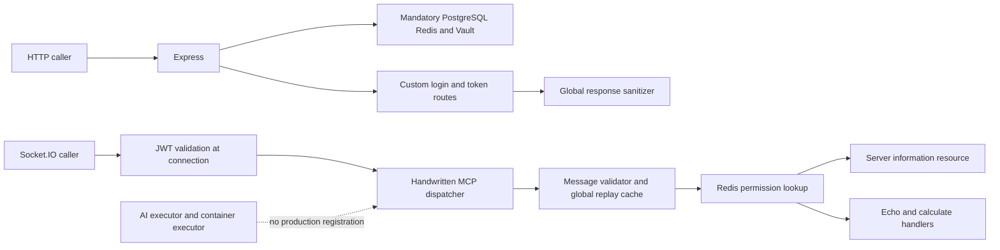

# Secure MCP repository assessment

Review date: October 26, 2026 (America/New_York). Baseline: `main` at `1df0af55bd2cebde48d643e3d3c852e64d37ce18`, also the remote main commit at review time.

**Assessment: this is an experimental prototype with substantial release blockers. It does not currently substantiate its production readiness, interoperability, or security claims.** The best route forward is a smaller server runtime built on the maintained MCP SDK, with tested authorization, explicit tool policies, reliable audit events, and a working installation path. Incrementally adding enterprise features to the current architecture would compound the problems.

The proposed implementation sequence is in [the execution roadmap](../ROADMAP.md). Application code was not changed during this assessment.

## Scope and evidence

The review covered entrypoints, protocol handling, client SDK, authentication, MFA, authorization, secrets, tool execution, deployment, packaging, tests, CI, documentation, licensing metadata, and the public repository's maintenance signals. The baseline contains 153 tracked files, approximately 16,256 lines under `src`, 16,877 under `tests`, and 8,925 under `docs`. Of 27 test files, four under `src/auth/__tests__` are outside the configured Jest project test patterns.

Checks ran in an isolated copy using Node 24.13.0 and npm 11.6.2. Dependencies were resolved on the review date because there is no root lockfile. Initial installation disabled lifecycle scripts; Prisma validation and generation were then run explicitly. A separate consumer installed a locally built package with normal lifecycle scripts. Audit counts describe that resolved tree, not a frozen historical release.

The diagnostic probes execute repository functions with controlled logger, storage, and infrastructure substitutes. Redis prefix behavior was checked against the installed ioredis command implementation and exercised through a storage model with those semantics. These are reproducible code-level findings, not a claim of penetration testing against a deployed service. No production credentials, live database, cloud account, or Kubernetes cluster was used. Full deployment, performance claims, and every advertised security capability remain unverified.

See [validation evidence](evidence/2026-10-26-summary.json), [function probes](evidence/reproduce-critical-paths.cjs), and [backup-code probe](evidence/reproduce-backup-code-generation.cjs).

| Check | Observed result | Interpretation |
| --- | --- | --- |
| `npm ci --ignore-scripts --no-audit --no-fund` | Fails: root lockfile missing | Release workflow and Docker builds cannot use the committed tree as written |
| `npm install --ignore-scripts --no-audit --no-fund` | Succeeds | A newly resolved development tree can be assembled |
| Prisma validate and generate with a synthetic database URL | Pass, deprecated preview-feature warning | Schema syntax is valid; no migration or database behavior established |
| `npm run typecheck` | Pass after Prisma generation | Limited assurance: strict mode is disabled and protocol types are `any` |
| `npm run build` | Pass | Compilation is not evidence of a working server or distributable package |
| `npm run lint` | 2 errors, 162 warnings | Fails the repository's own command |
| `npm run test:unit -- --runInBand` | 6 suites fail, 3 pass; 52 tests fail, 179 pass | Unit baseline is red |
| Targeted MCP protocol security suite | 7 fail, 28 pass | Protocol/security behavior is not covered by a passing baseline |
| Broader security suite, excluding scanner and performance frameworks | Externally stopped at 60 seconds | No complete suite result; backup-code generation independently hangs |
| `npm audit --omit=dev --json` | 23 findings: 2 critical, 11 high, 7 moderate, 3 low | Dependency remediation and reachability assessment required |
| `npm pack --dry-run --ignore-scripts --json` | 126 files, 1,038,502 unpacked bytes | Includes 12 compiled test artifacts; excludes Prisma schema |
| Clean package consumer | Install succeeds; Prisma client construction fails | Installed package cannot initialize its required database client |
| Production logger import | Throws on invalid redaction path `x-api-key` | Production startup fails before normal initialization |
| Example environment validation | Missing `VAULT_URL`, missing `SESSION_SECRET`, short JWT placeholder | Copying the example does not produce a valid configuration |
| `docker compose config --quiet` | Pass with obsolete-version warning | YAML validity only; missing files and service configuration still prevent a working stack |
| `kubectl kustomize kubernetes/overlays/dev` | Fails ConfigMap generator merge | Documented development deployment cannot render |
| `helm lint helm/secure-mcp` | Pass with four missing chart dependencies | Not an installation or runtime validation |

## Architecture and product fit

The functioning code paths are much narrower than the repository's surface area suggests:

There is no standard stdio or Streamable HTTP MCP endpoint. The HTTP MCP router exposes information, status, and metrics routes. The two registered tools are `echo` and `calculate`; there is one example resource. The AI executor simulates responses and the container executor is not registered with the server. Authentication state is mostly kept in Redis despite an extensive Prisma data model, without a coherent provisioning and permission synchronization path.

Useful material remains: separation into recognizable modules, schema definitions, some input constraints, signed JWT validation with issuer/audience checks, attempts at rate limiting and permission filtering, deployment intent, and adversarial test ideas. Treat these as requirements and candidate fixtures to verify. They are not sufficient evidence to preserve the present implementations.

| Area | Readiness | Main gap |
| --- | --- | --- |
| MCP interoperability | Blocked | Custom transport and contradictory version validation |
| Authentication and authorization | Blocked | Broken initialization, responses, refresh, revocation, MFA, and policy storage |
| Developer installation | Blocked | Missing lockfile, invalid example, absent public server API |
| Package and container release | Blocked | Consumer failure and unreproducible Docker/release paths |
| Verification | Blocked | Failing tests, missing Jest setup, permissive CI |
| Security assurance | Unsubstantiated | Mock controls and unconditional passing security checks |
| Operations | Experimental | Production logger failure, stub tracing, inconsistent metrics and shutdown |
| Open source credibility | Needs correction | License conflict, unsupported claims, minimal maintainer/community machinery |

## Prioritized findings

Priority describes execution order. P0 means a release blocker, not necessarily an exploitable critical vulnerability. Security impact and prerequisites are stated separately. A broken startup path can currently mask a serious defect that becomes reachable after an unrelated fix.

### F01 P0 Protocol initialization contradicts the configured protocol

`src/config/config.ts:96` defaults to the date-based protocol `2024-11-05`. `src/server/mcp-security.ts:40` accepts only a semantic version string such as `0.5.0`. `src/server/websocket-manager.ts:327` then requires equality with the configured value. The default initialization request therefore cannot pass both checks. The probe rejected the default version and accepted the semver form at the validation layer.

The README also confuses SDK package version 0.5.0 with a protocol version. Handwritten SDK type aliases at `src/server/websocket-manager.ts:2` erase the contracts that would help expose this mismatch. Replace the dispatcher and wire validation with the maintained SDK; declare and test supported protocol versions.

### F02 P0 Standard MCP transports and the advertised server API are absent

`src/index.ts:45` starts Socket.IO. `src/server/routes.ts` contains only GET routes, so the client's POST to `/api/mcp` has no handler. `src/index.ts` exports no `SecureMCPServer` constructor despite the README example. Importing the package starts the application and prints a banner instead of giving a side-effect-free library API. There is no package `bin` entry for an executable stdio server.

Implement a small library entrypoint and separate CLI over standard transports. Any retained Socket.IO compatibility must be explicitly isolated and tested.

### F03 P0 Authentication bootstrap and output handling make login unusable

The shared JWT and MFA services are constructed at `src/auth/middleware.ts:500`, but application startup never initializes them. `src/auth/routes.ts:15` constructs SSO without initializing it. The socket authenticator initializes a different JWT instance, which does not initialize the HTTP singleton.

Independently, `src/index.ts:95` installs `SecurityMiddleware.sanitizeOutput` globally. Its recursive field filter at `src/security/middleware.ts:207` drops any key containing `token`, `secret`, `password`, or `key`. The probe transformed a successful login payload into only `success` and `expiresIn`, removing access, refresh, and temporary tokens. It also conflicts with MFA enrollment responses.

There is also a secrets-provider contract mismatch: `src/security/vault.ts:101` returns the unwrapped secret object, while JWT and MFA initialization look under `secrets.data`. Fixing startup alone would not make those configured secrets load correctly.

Use explicit lifecycle ownership and response schemas. Redaction belongs in logging and defined data-release policies; it must not silently destroy intended API contracts.

### F04 P0 Fresh refresh tokens are rejected as replay attacks

`src/auth/jwt-service.ts:146` generates a distinct refresh-token JTI, while the family record at line 170 stores the access-token JTI. Refresh compares that record with the refresh-token JTI at line 297. The first legitimate refresh therefore reaches the replay-attack branch. A probe using actual signing and verification reproduced `Invalid refresh token - security violation detected`.

If this custom identity subsystem is retained, model access tokens, refresh families, session ownership, rotation, reuse detection, and atomic consumption explicitly. The recommended replacement delegates token issuance and MFA to an identity provider.

### F05 P0 Revocation has both a namespace bug and a cross-user scope bug

`src/database/redis.ts:24` configures `keyPrefix: 'mcp:'`. ioredis prefixes keyed commands, but not the pattern passed to `KEYS`. Calls such as `keys('active_token:*')` in `src/auth/jwt-service.ts:370` therefore do not find the prefixed records. The modeled production-prefix probe left both the selected access token and refresh family active.

If prefixes are removed or only the scan is repaired, `revokeSession` and `revokeAllUserTokens` delete active tokens without checking record ownership. The unprefixed probe showed Alice's session revocation also deleting Bob's access token. `enforceSessionLimit` similarly counts all sessions, and blacklist enumeration repeats the ownership problem.

Do not fix only the scan. Replace global key scans with user/session indexes and atomic, ownership-checked operations. Add two-user and two-session tests. Refresh must verify active session state. Existing sockets must also be invalidated or reauthorized; they currently retain connection identity after token expiry or logout.

### F06 P0 MFA secret storage does not use secret key material

`src/auth/mfa-service.ts:107` supplies `userId:userEmail` as the password for PBKDF2-based encryption. Active-secret paths use `userId`. The cryptographic helper derives its key entirely from that argument and the stored salt. The loaded MFA master key is not used by these paths.

The probe recovered an encrypted enrollment secret using only the stored record and public identity context. An attacker with a relevant Redis dump and identity data would not need the configured master key to decrypt it. This is a high-impact confidentiality defect, conditional on access to that stored data. AES-GCM and a high iteration count do not repair the missing secret.

Prefer provider-managed MFA. If retained, use authenticated encryption under a managed secret key, explicit key IDs, and identity as authenticated associated data, with a migration plan for existing records.

### F07 P0 MFA enrollment and backup-code generation are broken

Enrollment encrypts with `userId:userEmail`, but setup verification at `src/auth/mfa-service.ts:163` decrypts with `userId`. The probe reproduced decryption failure.

`src/auth/crypto/totp-generator.ts:39` generates eight-character backup codes and requires measured string entropy of at least 40 bits. Its frequency-based calculation can reach at most `8 * log2(8) = 24` bits for any eight-character string. The generation loop can never accept a code. A separate process calling generation failed to return before an external two-second timeout. This synchronous loop would block the event loop if reached from a repaired enrollment route.

The route's numeric MFA-token validation also excludes alphabetic backup codes. `isMFAEnabled` returns false on storage errors, and replay checks use separate reads and writes. These are further reasons to remove this subsystem from the new default runtime rather than patching it piecemeal.

### F08 P0 Production logging prevents startup and loses audit context

The production redaction configuration in `src/utils/logger.ts:58` contains bare hyphenated paths such as `x-api-key`, which the installed Pino redactor rejects. Importing the logger with `NODE_ENV=production` throws immediately.

Most call sites use `logger.info(message, object)` or the corresponding error method. The exported logger is raw Pino, which expects the structured object first. A direct logger probe produced the message but omitted the supplied user, tool, and decision fields. The production file destinations also do not match the writable directories in the container configuration.

Use validated logging configuration, structured-object-first calls, stderr/stdout appropriate to transport, and tests for redaction and required audit fields. No audit-integrity claim should survive without this evidence.

### F09 P0 The package is not usable as documented

The package allowlist contains `dist`, README, and LICENSE but not `prisma/schema.prisma`. A fresh consumer installation of the locally packed server succeeded; constructing its Prisma client failed with the instruction to run `prisma generate`. The required schema is absent from the artifact. Meanwhile, the compiler includes `src/auth/__tests__`, shipping 12 test-related JavaScript, declaration, and map files.

Make artifact installation, exported API usage, and CLI startup release gates. Prefer eliminating Prisma from the minimal runtime; otherwise package and test its generation and migration lifecycle explicitly.

### F10 P0 CI and security reports cannot establish release quality

The CI workflow tolerates lint and test failures. The security workflow tolerates audit and security-test failures. Publication is triggered separately and does not depend on successful validation of the same commit and artifact. Root `npm ci` currently cannot run.

Jest's effective child-project configurations have no `setupFilesAfterEnv` or module aliases and use the default Babel transform, rather than the root ts-jest configuration. This explains missing custom matchers and weakens the intended test setup. Four source-local test files are undiscovered, and force-exit can conceal resource leaks.

`tests/security/automated-security-framework.test.ts:836` onward records PASS for MFA, advanced sessions, data protection, business logic, AI security, and infrastructure without exercising those controls. Other integration tests construct partial apps, mock storage contracts different from production, and omit global middleware. Consequently, test volume is not meaningful assurance.

Make required checks blocking, repair configuration, preserve real regression cases, and replace unconditional success with verified outcomes or explicit unsupported status. The branch API reported main unprotected and the repository ruleset API returned an empty list. Configuration changes should enforce the required checks before future releases.

### F11 P1 Dependencies and the runtime baseline need renewal

The resolved production graph has 23 audit findings. The two critical package entries are `passport-saml` and `tar`; high entries include the old MCP SDK, Express, Socket.IO, ws, Joi, and Zod. The [SAML signature advisory](https://github.com/advisories/GHSA-4mxg-3p6v-xgq3) is especially relevant if SSO is enabled. Presence in the dependency tree is not proof every advisory is remotely reachable; installer dependencies, dormant SSO, and active HTTP dependencies need separate treatment.

CI and Docker pin Node 20, which is now EOL according to the [Node release table](https://nodejs.org/en/about/previous-releases). Remove unnecessary dependencies first, adopt a supported runtime, lock the remaining graph, and triage advisory applicability. Avoid a blind major-version audit fix across this architecture.

### F12 P1 Advertised isolation and AI protections are not enforced by the server

Network isolation, user namespaces, resource control, capability application, and MAC profile helpers include mock implementations. Some return invented identifiers and fixed metrics. Container image signature checking is a registry-prefix test, and a failed check only logs a warning. The container executor is not connected to production tool dispatch, so these are dormant implementation defects, not proof of a currently reachable container escape.

Likewise, `src/tools/ai-tool-executor.ts:204` simulates AI execution, and the production dispatcher never invokes it or prompt screening. Regex detection and text rewriting cannot establish a general prompt-injection boundary. Keep untrusted execution disabled until OS-level isolation is implemented and tested. Treat content screening as an optional, measured policy signal with documented limits.

### F13 P1 Authorization and schema enforcement have inconsistent sources of truth

MCP handlers fetch a Redis set named `user_permissions:<id>` at `src/server/websocket-manager.ts:657`, but production code does not populate that set. HTTP authentication and SSO instead use permissions stored in user records and token claims. The initial examples can therefore remain unavailable to users whose other authentication paths appear configured.

Handlers accept any one required permission, and tools without permissions default to allowed. Tool schemas are advertised but not used to validate invocation arguments; the probe accepted `echo` without its required `text`. Registry ownership, deny-by-default behavior, AND/OR policy semantics, and trusted caller identity need a single implementation shared by discovery and execution.

### F14 P1 Request handling breaks legitimate clients and mutates data

The singleton replay cache in `src/server/mcp-security.ts:118` hashes entire messages without a caller namespace. Two clients sending the same request ID and body collide for 60 seconds. Request ID zero is rejected, while standard JSON-RPC permits it. Required tool arguments are not enforced, nested arguments can disappear, and strings are HTML-sanitized and silently truncated. This changes tool meaning and is particularly unsuitable for security analysis inputs.

The server also advertises resource subscription/list-change capabilities without implementing the corresponding complete behavior, and returns resource content without its required resource URI. Use the SDK's schema and result contracts, preserve permitted input exactly, and scope any business-level idempotency to principal and operation.

### F15 P1 The bundled client does not implement the server's contract

`packages/client-sdk/src/index.ts` omits `jsonrpc`, sends object messages while the server parses strings, expects object responses while the server sends strings, calls `tools/execute` instead of `tools/call`, and does not initialize the protocol. Its authentication object contains header-shaped keys while the socket authenticator looks for `auth.token` or an actual authorization header. HTTP fallback targets the missing POST endpoint.

Deprecate this client in favor of the official SDK and prove interoperability with independent clients. If a compatibility client remains, give it an explicit migration and test matrix.

### F16 P1 Deployment paths contain incompatible and missing components

The example uses `VAULT_ENDPOINT`, Compose uses `VAULT_ADDR`, and code requires `VAULT_URL`. The example lacks `SESSION_SECRET`. Referenced Vault initialization, PostgreSQL initialization, Nginx, monitoring, and load-test files are missing. Compose requires PostgreSQL certificate paths without supplying the certificates. Its Redis health command does not authenticate to the password-protected server and does not verify a PONG result.

Kustomize cannot merge its ConfigMap generator into the declared base as written. Its database migration init container invokes npm, but the production Docker image explicitly removes npm. There are no committed Prisma migrations. Metrics manifests expect port 9090 although metrics are attached to the main application listener. Docker's security-scan stage is not a dependency of the final production stage, so it is not a reliable build gate.

Reduce to one working local installation and one tested container deployment before maintaining Helm and Kustomize variants. Rendering checks must be followed by isolated startup and functional tests.

### F17 P1 Documentation and licensing metadata undermine trust

The root LICENSE notice declares AGPL v3 or later, while both package manifests, contributor terms, and Helm metadata declare Apache-2.0. GitHub reports `NOASSERTION`. Resolve this against the maintainer's intended license and contribution history; include the full license text and consistent SPDX metadata. This review does not authorize changing the licensing decision.

The docs claim production readiness, certificate pinning, queue integrations, compliance, and performance levels without corresponding implementation or measured evidence. README benchmarks include 10,000 requests/second and 50,000 connections despite a default 1,000-connection cap and no reproducible benchmark artifact. Several docs and chart fields reference `enterprise`, example contacts, or absent scripts. Labels such as `CVE-2024-SMCP-001` should be internal finding IDs unless an actual assigned advisory can be cited.

Rewrite around verified behavior, installation, threat assumptions, and explicit support status. Remove invented assurance instead of expanding the compliance prose.

### F18 P2 Resource management and observability need real operating limits

`src/monitoring/metrics.ts:399` exposes metrics before authentication; labels include user IDs, raw request paths, and resource identifiers. Raw paths are selected before routing at line 356, allowing growing series cardinality from varied URLs. Tracing setup is a stub, and its callback signature also differs from how some helpers invoke it.

The tool handler has no enforced `MCP_TIMEOUT`, cancellation, concurrency bound, or backpressure. Socket authorization happens at connect time. Cleanup can decrement connection counts both during disconnect handling and afterward. Shutdown does not explicitly drain Socket.IO, cancel tool work, or clear all service timers; cluster restart logic needs coordinated termination. These issues require bounded-load, cancellation, shutdown, and failure-injection tests before availability claims.

## Current ecosystem bar

The target must be selected against current sources. On the review date, the authoritative MCP specification is [2026-07-28](https://modelcontextprotocol.io/specification/2026-07-28). It uses stateless requests, per-request protocol metadata, and `server/discover`. The [change log](https://modelcontextprotocol.io/specification/2026-07-28/changelog) also changes result shapes, cache metadata, and streaming semantics. A modernization plan based only on the older initialization handshake would already be behind.

The official [TypeScript SDK documentation](https://ts.sdk.modelcontextprotocol.io/) identifies v2 as stable and separates server/client packages; v1 remains a maintenance line for older protocol versions. Use the [v2 guides](https://ts.sdk.modelcontextprotocol.io/v2/) and its compatibility support instead of hand-porting every protocol detail. Standard [transports](https://modelcontextprotocol.io/specification/2026-07-28/basic/transports) remain stdio and Streamable HTTP.

For protected HTTP deployments, implement the resource-server role and discovery described by [MCP authorization](https://modelcontextprotocol.io/specification/2026-07-28/basic/authorization). Apply relevant [MCP security guidance](https://modelcontextprotocol.io/docs/tutorials/security/security_best_practices), including audience validation, no token passthrough, SSRF controls where network access exists, and ownership-bound state handles.

Other projects already provide basics worth matching. [GitHub's server configuration](https://github.com/github/github-mcp-server/blob/main/docs/server-configuration.md) exposes explicit tool filtering and enforceable read-only behavior. [FastMCP authorization](https://gofastmcp.com/servers/authorization) documents consistent discovery and invocation checks. Those features alone are not a distinctive product. Secure MCP's opportunity is a small TypeScript runtime whose enforced boundaries are understandable, testable, and backed by reproducible adversarial cases.

## Open source adoption assessment

The GitHub snapshot showed two stars, no forks, no open issues, and discussions disabled. These are observations, not a judgment of the idea's potential. Both server and client packages report npm `latest` version 1.0.0. The public GitHub release is dated September 27, 2025, while CHANGELOG dates 1.0.0 to January 9, 2026. The most recent main push's [CI run was cancelled](https://github.com/perfecxion-ai/secure-mcp/actions/runs/22083726798), and its [security run failed](https://github.com/perfecxion-ai/secure-mcp/actions/runs/22083726793). The five latest returned scheduled runs were also failed or cancelled.

A credible relaunch needs a specific user problem, a five-minute first success, independently tested clients, honest security documentation, a clear license, reproducible releases, and visible maintenance. Registry publication should follow artifact verification; the [official registry guide](https://modelcontextprotocol.io/registry/quickstart) requires package metadata and `server.json` to agree. Registry presence and star counts should not substitute for returning users and working integrations.

## Recommendation

Build a successor release with a narrow promise: **host approved tools over standard MCP transports with explicit access policies, bounded execution, and useful audit evidence**. Preserve the namespace and verified requirements, replace custom protocol and identity plumbing, and retire unsupported claims. Keep the legacy implementation out of the default runtime once migration is complete.

The first execution milestone is release containment and a truthful baseline. The next is one useful tool working through an independent MCP client from a clean package installation. Only then should broader policy, remote authentication, isolation, and ecosystem expansion be treated as release candidates.
