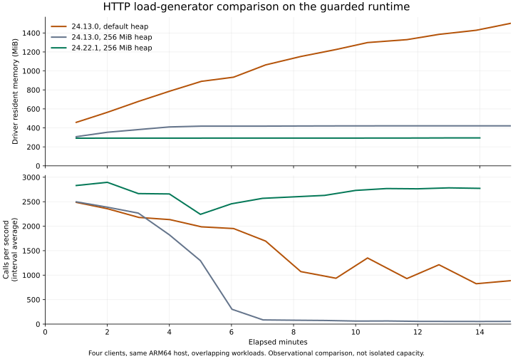

# Validation evidence

Reports identify a workload and a particular runtime. The [run identity record](2026-10-27-endurance-run-identities.json) ties completed guarded runs to source/build hashes and separately records their process exit status. Passing results are not transferable to arbitrary tools, clients, deployment settings, or later source changes.

## Current candidate

[Human reviews passed according to the maintainer](2026-10-28-human-review.md). The [GitHub prerelease is published and verified](2026-10-29-published-alpha.json); exact review metadata remains distinct from the technical acceptance reports.

The [reported attack review](2026-10-27-reported-attack-review.md) records maintainer-supplied findings against the same runtime source. Its provenance and missing raw-artifact limits are explicit; it is separate from the reproduced acceptance below.

Use the [candidate record](CANDIDATE.md) for the current runtime and the [fresh-install guide](REAL_USER_VALIDATION.md) for the trial. It contains the 44-test, actual browser/issuer, durable collector, storage failure, real-host, container, and immutable artifact evidence. Its final endurance status is recorded explicitly rather than inferred from older results.

The guarded-runtime and initial-alpha reports below are historical. Their runtime module hashes differ from the current candidate.

## Guarded runtime

Runtime source: `c0a5f95b48253f69451be0cc8d7447f5eb970917`. Later lab and documentation changes do not change its compiled runtime modules. Each host/proxy report in this historical section contains SHA-256 hashes of its 12 built JavaScript modules.

| Evidence                                           | Result and boundary                                                                                 |
| -------------------------------------------------- | --------------------------------------------------------------------------------------------------- |
| [Codex](2026-10-27-guarded-codex-host.json)        | Actual Codex 0.164.0, three stdio calls, command execution disabled                                 |
| [Claude Code](2026-10-27-guarded-claude-host.json) | Actual Claude Code 2.1.307, same workflow, existing login used without stored configuration changes |
| [NGINX TLS proxy](2026-10-27-guarded-proxy.json)   | Verified HTTPS, modern and legacy protocols, authorization and Host/Origin checks                   |
| [Native coverage](2026-10-27-guarded-coverage.txt) | 33 passing tests; 96.31% lines, 90.31% branches, 92.31% functions                                   |

The [older-Node HTTP diagnostic](2026-10-27-http-node24-old-diagnostic.json) completed with 13 request errors in 1,386,459 calls and a maximum driver event-loop stall of 20.75 seconds. It used the guarded runtime and Node 24.13.0. The [standalone AbortSignal probe](../reviews/evidence/reproduce-abort-signal.mjs) completed one million operations in [1.75 seconds on Node 24.22.1](2026-10-27-abort-signal-node24-current.json); the [24.13.0 attempt was stopped after at least 120 seconds](2026-10-27-abort-signal-node24-old-stopped.json) without completing. These observations support investigating the client runtime; they do not prove the exact cause of every HTTP failure.

The [15-minute current-Node comparison](2026-10-27-http-node24-current-diagnostic.json) completed 2,410,303 calls with zero unexpected results on Node 24.22.1 and a 256 MiB driver heap limit. Its maximum sampled driver RSS was 294.4 MiB and its maximum event-loop delay was 28.61 ms. The [older-Node 256 MiB driver](2026-10-27-http-node24-old-bounded.json) completed its 30-minute workload with 724,453 calls and zero result mismatches, but throughput degraded and the runner reported exit status 143. It is not counted as a clean pass. Reducing its heap did not restore sustained throughput. The reason for that exit status was not established.

The chart shows the first 15 minutes from the checked-in progress reports. Runs overlapped with other work, so this is an observational comparison rather than a controlled capacity claim. The [rendering script](render-http-comparison.py) uses Matplotlib and can regenerate the SVG from those reports.

The [artifact verification record](2026-10-27-guarded-artifact-verification.json) verifies the exact tarball from main commit `eee12d17c5bb86559fdad12785b67b4d1614696b`, requiring this repository's CI workflow and main ref. Both build provenance and the production SBOM verified; an altered tarball was rejected. All 12 packaged JavaScript module hashes match the guarded local lab builds. This does not mean the artifact was published or promoted.

Both extended guarded-runtime runs completed with exit status 0:

| Run                                                 | Node    | Duration   | Calls      | Unexpected results | Last-10,000 p95 | Peak sampled server RSS |
| --------------------------------------------------- | ------- | ---------- | ---------- | ------------------ | --------------- | ----------------------- |
| [stdio](2026-10-27-guarded-stdio.json)              | 24.13.0 | 60 minutes | 16,901,942 | 0                  | 2.00 ms         | 242.60 MiB              |
| [HTTP](2026-10-27-guarded-http-node24-current.json) | 24.22.1 | 30 minutes | 5,094,415  | 0                  | 2.11 ms         | 345.98 MiB              |

The HTTP driver used a 256 MiB heap limit and its maximum measured event-loop delay was 28.08 ms. The [ARM64 container check](2026-10-27-guarded-arm64-container.json) also passed on Node 24.22.1 with the same 12 runtime module hashes. These reports establish their recorded workflows, not an isolated capacity or production-readiness claim. The failed older-Node results remain below.

## Historical runs

| Evidence                                                               | Interpretation                                                                                                           |
| ---------------------------------------------------------------------- | ------------------------------------------------------------------------------------------------------------------------ |
| [Initial one-hour stdio](2026-10-26-initial-soak.json)                 | 12,550,140 calls, zero unexpected results; predates audit-stream and oversized-frame lifecycle fixes                     |
| [Follow-up one-hour stdio](2026-10-27-before-element-guard-stdio.json) | 14,170,871 calls, zero unexpected results; includes lifecycle fixes, predates the input-element guard                    |
| [Initial HTTP endurance](2026-10-27-before-element-guard-http.json)    | 2,219,345 calls, 54 unexpected results; Node 24.13.0 driver, no per-failure diagnostics, predates the element guard      |
| [Initial alpha record](2026-10-27-alpha.json)                          | Earlier local candidate and its file hashes; historical 30-test, package, container, and issuer checks                   |
| Initial `codex-host.json` and `claude-host.json` reports               | Earlier host acceptance before the element guard; superseded for current runtime identification by guarded reports above |

All load measurements ran on the same ARM64 DGX Spark host. Background validation and overlapping load runs occurred; these were not isolated capacity benchmarks. These historical reports use a small local document, four callers, and JSON audit to `/dev/null`; the current candidate separately measures acknowledged durable audit. Stdio `startupMs` measures transport connection rather than first-call readiness. Latency percentiles cover the last 10,000 calls, not all calls. See [benchmark instructions](../BENCHMARKS.md).

Only synthetic fixtures and filtered reports belong here. Do not add raw assistant transcripts, credentials, issuer keys, real document contents, or local Git configuration.
